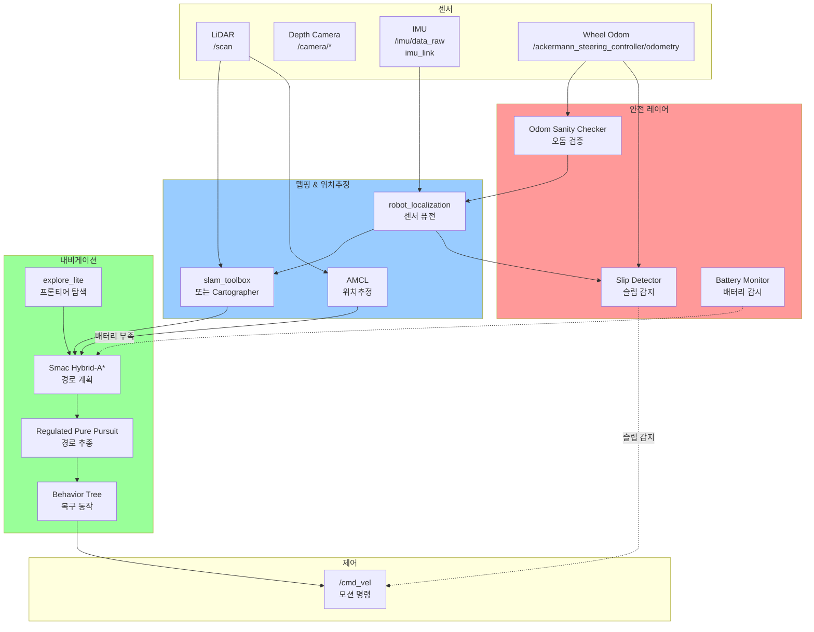

# R2 자율주행 레이어 (R2 Autonomy Layer)

Yahboom ROSMASTER R2 로봇을 위한 완전 자율주행 패키지입니다. Ackermann 조향 방식에 최적화되어 있으며, 맵 구축, 탐색, 순찰, 재위치 추정 기능을 제공합니다.

## 주요 기능

- **자동 맵 구축**: slam_toolbox 또는 Cartographer를 사용한 SLAM
- **자율 탐색**: 미지의 영역을 자동으로 탐색 (frontier-based exploration)
- **경로 순찰**: 저장된 맵에서 자율 주행 및 순찰
- **재위치 추정**: 로봇이 들어 올려진 후 위치 자동 재추정
- **휠 슬립 감지**: 바퀴 미끄러짐 감지 및 3초 지속 시 긴급 정지
- **배터리 모니터링**: 10.5V 이하 시 자동 귀환
- **Odom 안정화**: 비정상적인 odom 점프 (649m 등) 보정
- **복구 동작**: 장애물 막힘 시 후진 복구

## 시스템 구조



## 노드 및 토픽 구조

### 핵심 노드

| 노드 | 패키지 | 역할 |
|---|---|---|
| `slip_detector` | r2_autonomy | 휠 슬립 감지, 3초 지속 시 긴급 정지 |
| `battery_monitor` | r2_autonomy | 배터리 전압 모니터링, 10.5V 이하 시 귀환 |
| `odom_sanity_checker` | r2_autonomy | 비정상적 odom 점프 보정 (Cartographer 크래시 방지) |
| `slam_toolbox` | slam_toolbox | 온라인 SLAM, 맵 구축 |
| `explore` | explore_lite | 프론티어 기반 자율 탐색 |
| `amcl` | nav2_amcl | 맵 기반 위치 추정 |
| `planner_server` | nav2_planner | Smac Hybrid-A* 경로 계획 |
| `controller_server` | nav2_controller | Regulated Pure Pursuit 제어 |
| `bt_navigator` | nav2_bt_navigator | 행동 트리 기반 내비게이션 |

### 주요 토픽

| 토픽 | 타입 | 설명 |
|---|---|---|
| `/scan` | sensor_msgs/LaserScan | LiDAR 스캔 (SENSOR QoS) |
| `/odom` | nav_msgs/Odometry | EKF 융합 오도메트리 |
| `/odom_safe` | nav_msgs/Odometry | 안정화된 오도메트리 (선택) |
| `/cmd_vel` | geometry_msgs/Twist | 모션 명령 |
| `/map` | nav_msgs/OccupancyGrid | 점유 격자 맵 |
| `slip_detected` | std_msgs/Bool | 슬립 상태 |
| `battery_voltage` | std_msgs/Float32 | 배터리 전압 |

## 설치

### 1. 의존성 설치

```bash
cd ~/ROSMASTER-R2-fork/code/yahboomcar_ros2_ws/src/r2_autonomy
bash install_dependencies.sh
```

### 2. 패키지 빌드

```bash
cd ~/ROSMASTER-R2-fork/code/yahboomcar_ros2_ws
colcon build --packages-select r2_autonomy --symlink-install
source install/setup.bash
```

자세한 내용은 [INSTALL.md](INSTALL.md)를 참고하세요.

## 사용법

### 모드별 실행

r2_autonomy는 4가지 모드를 제공합니다.

#### 1. 맵 구축 모드 (map_mode)

SLAM을 사용하여 환경 맵을 생성합니다.

```bash
# 먼저 로봇 기본 시스템 실행 (별도 터미널)
ros2 launch yahboom_r2_bringup r2_bringup.launch.py use_slam:=false use_ekf:=true

# r2_autonomy 맵 모드 실행
ros2 launch r2_autonomy map_mode.launch.py

# RViz에서 맵 확인
rviz2 -d $(ros2 pkg prefix r2_autonomy)/share/r2_autonomy/config/r2_nav.rviz
```

맵 저장:

```bash
ros2 run nav2_map_server map_saver_cli -f ~/my_map
```

#### 2. 탐색 모드 (explore_mode)

미지의 영역을 자동으로 탐색하며 맵을 구축합니다. `explore_lite`(m-explore-ros2 Humble)가 설치되어 있어야 하고, 실제 출발은 운영자가 지시할 때만 합니다.

배터리 전압이 `/battery_voltage`에서 `stop_voltage`(기본 10.5 V) 아래로 내려가면 `explore_battery_guard`가 탐색을 멈추고 Nav2 목표를 취소합니다. 이 노드는 `/cmd_vel`을 발행하지 않습니다.

R2는 Ackermann이라 `use_rotate_to_heading`은 false로 둡니다. 출발할 때 목표 쪽으로 도는 것은 경로 계획(후진 페널티)이 담당하고, 후진(`allow_reversing`)은 탈출·복구용입니다.

```bash
# 인자 확인 (노드는 시작하지 않음)
ros2 launch r2_autonomy explore_mode.launch.py --show-args

# 스택이 이미 떠 있을 때 탐색만 붙이려면 (출발 지시 후에만)
ros2 launch r2_autonomy explore_mode.launch.py start_nav_stack:=false

맵을 만들 때 센서와 `/cmd_vel` 을 같이 남기려면 저장소의 `scripts/record_mapping_bag.sh` 를 씀. 기본 출력은 `/data/bags` 이고, 완료된 분할을 PC 로 보내는 스크립트는 `scripts/offload_bags.sh` (자동 시작하지 않음). 자세한 내용은 `scripts/README.md` 참고.

```

#### 3. 순찰 모드 (patrol_mode)

저장된 맵에서 자율 주행 및 순찰을 수행합니다.

```bash
# 로봇 기본 시스템 실행
ros2 launch yahboom_r2_bringup r2_bringup.launch.py use_slam:=false use_ekf:=true

# 순찰 모드 실행 (맵 파일 지정)
ros2 launch r2_autonomy patrol_mode.launch.py map:=/path/to/your/map.yaml
```

RViz에서 "Nav2 Goal" 버튼으로 목표 지점을 지정하거나, waypoint 파일을 사용할 수 있습니다.

#### 4. 재위치 추정 모드 (localize_mode)

로봇이 들어 올려지거나 위치를 잃었을 때 전역 재위치 추정을 수행합니다.

```bash
# 로봇 기본 시스템 실행
ros2 launch yahboom_r2_bringup r2_bringup.launch.py use_slam:=false use_ekf:=true

# 재위치 추정 모드 실행
ros2 launch r2_autonomy localize_mode.launch.py map:=/path/to/your/map.yaml

# 전역 재위치 추정 트리거
ros2 service call /reinitialize_global_localization std_srvs/srv/Empty
```

### 주요 파라미터 조정

#### 슬립 감지 임계값

`config/nav2_params_ackermann.yaml` 또는 launch 파일에서:

```yaml
slip_threshold_linear: 0.10  # 선속도 차이 임계값 (m/s)
slip_threshold_angular: 0.15  # 각속도 차이 임계값 (rad/s)
slip_duration_limit: 3.0      # 슬립 지속 제한 시간 (초)
```

#### 배터리 임계값

```yaml
low_battery_threshold: 10.5  # 저전압 임계값 (V), 약 20%
home_x: 0.0                   # 귀환 위치 X (m)
home_y: 0.0                   # 귀환 위치 Y (m)
```

#### 내비게이션 속도

```yaml
desired_linear_vel: 0.20      # 목표 선속도 (m/s)
min_approach_linear_velocity: 0.05  # 목표 접근 시 최소 속도
allow_reversing: true         # 후진 허용
```

#### 최소 회전 반경 (Ackermann)

R2의 실제 조향 제한에 맞춰 조정:

```yaml
minimum_turning_radius: 0.35  # 최소 회전 반경 (m)
```

## 설계 결정 사항

### 재사용된 오픈소스

| 컴포넌트 | 패키지 | 용도 |
|---|---|---|
| 경로 계획 | nav2_smac_planner | Smac Hybrid-A* (Reeds-Shepp, Ackermann 지원) |
| 경로 추종 | nav2_regulated_pure_pursuit_controller | RPP (Ackermann 최적화) |
| 충돌 감시 | nav2_collision_monitor | 0.40m 접근 감속, 0.20m 긴급 정지 |
| SLAM | slam_toolbox | 온라인 맵 구축 |
| 프론티어 탐색 | explore_lite (m-explore-ros2) | 자율 탐색 |
| 위치 추정 | nav2_amcl | 파티클 필터 기반 MCL |
| 센서 퓨전 | robot_localization | EKF (기존 사용 중) |
| 행동 트리 | nav2_bt_navigator | 복구 동작 관리 |
| 금지 필터 | nav2_costmap_2d::KeepoutFilter | 금지 구역 회피 |

### 새로 작성한 코드

| 컴포넌트 | 파일 | 역할 |
|---|---|---|
| **경로 추적 후진 복구** | `scripts/path_reverse_recovery.py` | **주행 경로를 따라 후진 + 조향 방향 교대 (180 lines)** |
| **자동 순찰 생성** | `scripts/patrol_waypoint_generator.py` | **맵에서 순찰 웨이포인트 자동 생성 (200 lines)** |
| 슬립 감지 (TF 기반) | `scripts/slip_detector.py` | TF map→base로 실제 모션 감지, 3초 지속 시 정지 |
| 배터리 모니터 | `scripts/battery_monitor.py` | 배터리 전압 감시, 귀환 트리거 |
| Odom 안정화 | `scripts/odom_sanity_checker.py` | 비정상 점프 보정 |
| 복구 행동 트리 | `behavior_trees/navigate_w_recovery.xml` | 후진 복구 로직 |
| Nav2 설정 | `config/nav2_params_ackermann.yaml` | R2 Ackermann 튜닝 + 깊이 카메라 + 충돌 모니터 |
| 충돌 모니터 설정 | `config/collision_monitor_params.yaml` | 0.40m/0.20m 구역 설정 |
| 금지 구역 | `maps/keepout_mask.yaml + .pgm` | 사용자 편집 가능 금지 구역 마스크 |
| Launch 파일 | `launch/*.launch.py` | 모드별 실행 스크립트 |
| 테스트 | `test/test_direction_alternation.py` | 방향 교대 로직 단위 테스트 |

### 왜 이런 선택을 했나?

1. **Smac Hybrid-A* + Regulated Pure Pursuit**: Ackermann 조향에 최적화. MPPI는 Orin Nano에서 연산 부담이 크므로 기본은 RPP, MPPI는 선택 사항으로 제공.

2. **slam_toolbox vs Cartographer**: slam_toolbox가 더 안정적이고 맵 저장/불러오기가 편리. Cartographer도 지원하지만 odom 점프 시 크래시 가능성 있음.

3. **explore_lite**: 가벼운 프론티어 기반 탐색. ROS 2 Humble에서 안정적.

4. **경로 추적 후진 복구**: Ackermann은 제자리 회전이 불가능하므로, 막힘 시 **주행했던 경로를 따라** 후진 (직선 후진 아님). 이후 다른 방향으로 전진 (좌/우 교대).

5. **슬립 감지 (TF 기반)**: 휠 오돔만으로는 미끄러짐을 모르므로, **TF map→base_footprint** (SLAM/AMCL 포즈)와 비교. EKF는 휠 인코더를 융합하므로 슬립 시 부정확.

6. **충돌 모니터 (0.40m/0.20m)**: 정지는 최후 수단. 0.40m에서 **감속** (접근 행동), 0.20m에서만 긴급 정지. 전방과 우전방 중심 다각형.

7. **자동 순찰 웨이포인트**: 사용자가 수동으로 찍지 않아도 맵의 자유 공간을 샘플링하여 순찰 경로 자동 생성. 루프 순찰.

8. **깊이 카메라 (유리 감지)**: 라이다는 유리를 투과하므로 깊이 카메라 포인트클라우드를 로컬 코스트맵에 추가. Orin Nano 부하 고려하여 2.0m 제한.

## 튜닝 가이드

### 실제 로봇에서 확인할 사항

1. **LiDAR 프레임 이름**: `/scan` 토픽의 `frame_id`가 `laser`인지 확인. 다르면 설정 파일 수정.

   ```bash
   ros2 topic echo /scan --field header.frame_id
   ```

2. **Depth 카메라 프레임**: `/camera/depth/points`의 `frame_id`는 `camera_depth_optical_frame`입니다.

3. **최소 회전 반경 측정**: 로봇을 최대 조향각으로 회전시켜 실제 회전 반경 측정, `minimum_turning_radius` 조정.

4. **슬립 임계값**: 미끄러운 표면에서 테스트 후 `slip_threshold_linear/angular` 조정.

5. **배터리 전압 파일**: `/dev/shm/r2_battery_v` 파일 존재 여부 및 값 확인.

   ```bash
   cat /dev/shm/r2_battery_v
   ```

6. **ROS_DOMAIN_ID**: 환경변수 확인 (실기 기본값 28).

   ```bash
   echo $ROS_DOMAIN_ID
   ```

### 성능 최적화 (Jetson Orin Nano)

- **코스트맵 해상도**: 0.05m (기본). 성능 문제 시 0.10으로 증가.
- **업데이트 주파수**: 로컬 5Hz, 글로벌 1Hz로 설정.
- **플래너 주파수**: 10Hz. CPU 부담 시 5Hz로 감소.
- **Voxel Layer**: 깊이 카메라 사용 시 활성화. 필요 없으면 비활성화.

## 검증 및 테스트

### 빌드 검증

```bash
cd ~/ROSMASTER-R2-fork/code/yahboomcar_ros2_ws
colcon build --packages-select r2_autonomy
```

에러 없이 빌드되어야 합니다.

### Lint 검증

```bash
cd ~/ROSMASTER-R2-fork/code/yahboomcar_ros2_ws/src/r2_autonomy
ament_flake8 .
ament_xmllint .
```

### 유닛 테스트

```bash
colcon test --packages-select r2_autonomy
colcon test-result --verbose
```

### 실제 로봇에서 확인할 사항

1. **센서 토픽 확인**
   ```bash
   ros2 topic list
   ros2 topic hz /scan
   ros2 topic hz /odom
   ```

2. **TF 트리 확인**
   ```bash
   ros2 run tf2_tools view_frames
   evince frames.pdf
   ```
   `map -> odom -> base_footprint -> base_link` 체인이 완전해야 합니다.

3. **맵 구축 테스트**
   - 맵 모드 실행 후 조이스틱으로 주행
   - RViz에서 맵이 정상적으로 생성되는지 확인

4. **슬립 감지 테스트**
   - 로봇 바퀴를 들어 공중에서 회전시키며 슬립 감지 확인
   - 3초 후 `/slip_detected` 토픽이 `true`가 되어야 함

5. **배터리 모니터 테스트**
   - `/dev/shm/r2_battery_v` 파일에 10.0 기록 후 귀환 동작 확인

6. **내비게이션 테스트**
   - 순찰 모드에서 Nav2 Goal 설정 후 자율 주행 확인
   - 장애물 회피 및 복구 동작 테스트

## 알려진 제한사항

1. **Cartographer odom 점프**: Cartographer는 큰 odom 점프에 민감. `odom_sanity_checker` 사용 권장.

2. **제자리 회전 불가**: Ackermann 조향이므로 제자리 회전이 불가능. 좁은 공간에서 제약이 있을 수 있음.

3. **후진 경로**: Smac Hybrid-A*는 후진을 지원하지만, 긴 후진 구간은 페널티가 있음. 짧은 후진만 사용.

4. **explore_lite 설치**: 기본 apt 저장소에 없을 수 있음. 소스에서 빌드 필요 (INSTALL.md 참고).

5. **Depth 카메라**: 로컬 코스트맵에 `/camera/depth/points` (`sensor_frame`: `camera_depth_optical_frame`) 추가됨. 토픽이 없으면 오류 없이 무시됨.

6. **경로 추적 후진**: 5초 이상 주행해야 충분한 경로 기록. 짧은 주행 후 막히면 직선 후진.

7. **금지 구역**: 빈 마스크가 제공됨. 사용자가 GIMP에서 흰색 영역을 그려야 함.

8. **슬립 감지**: TF map→base가 필요하므로 SLAM 또는 AMCL이 실행 중이어야 함. 맵 없이는 작동 안 함.

## 문제 해결

### 빌드 실패

- `yahboom_r2_bringup`과 `yahboomcar_description`이 먼저 빌드되었는지 확인.
- 의존성 패키지가 모두 설치되었는지 `install_dependencies.sh` 재실행.

### 내비게이션 실행 안됨

- `ros2 lifecycle list controller_server`로 노드 상태 확인.
- `/tf` 토픽이 제대로 발행되는지 확인: `ros2 topic echo /tf --once`.

### 슬립 감지 오작동

- `slip_threshold_linear/angular` 값을 늘려 민감도 감소.
- `/odom`과 `/ackermann_steering_controller/odometry` 토픽이 모두 발행되는지 확인.

### 배터리 모니터 작동 안함

- `/dev/shm/r2_battery_v` 파일이 존재하고 읽기 가능한지 확인.
- `ros2 topic echo /battery_voltage`로 전압값이 발행되는지 확인.

## 기여

이 패키지는 abraxas4 (moonjune.kim@gmail.com)가 개발했습니다.

## 라이선스

MIT License
