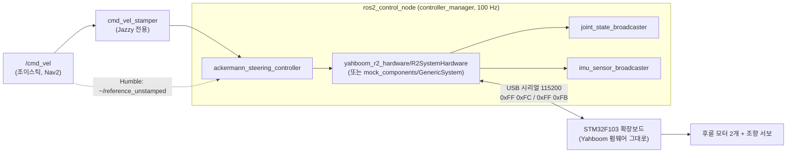
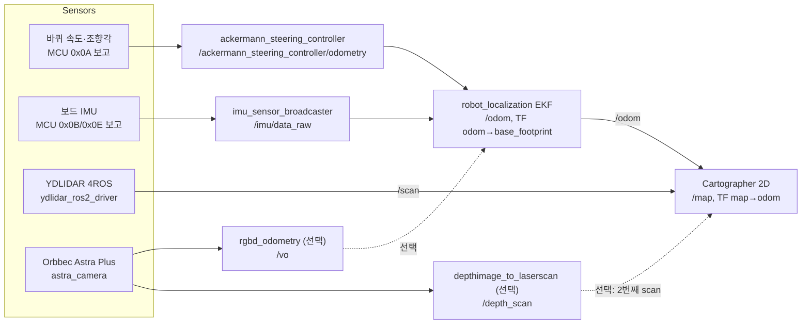
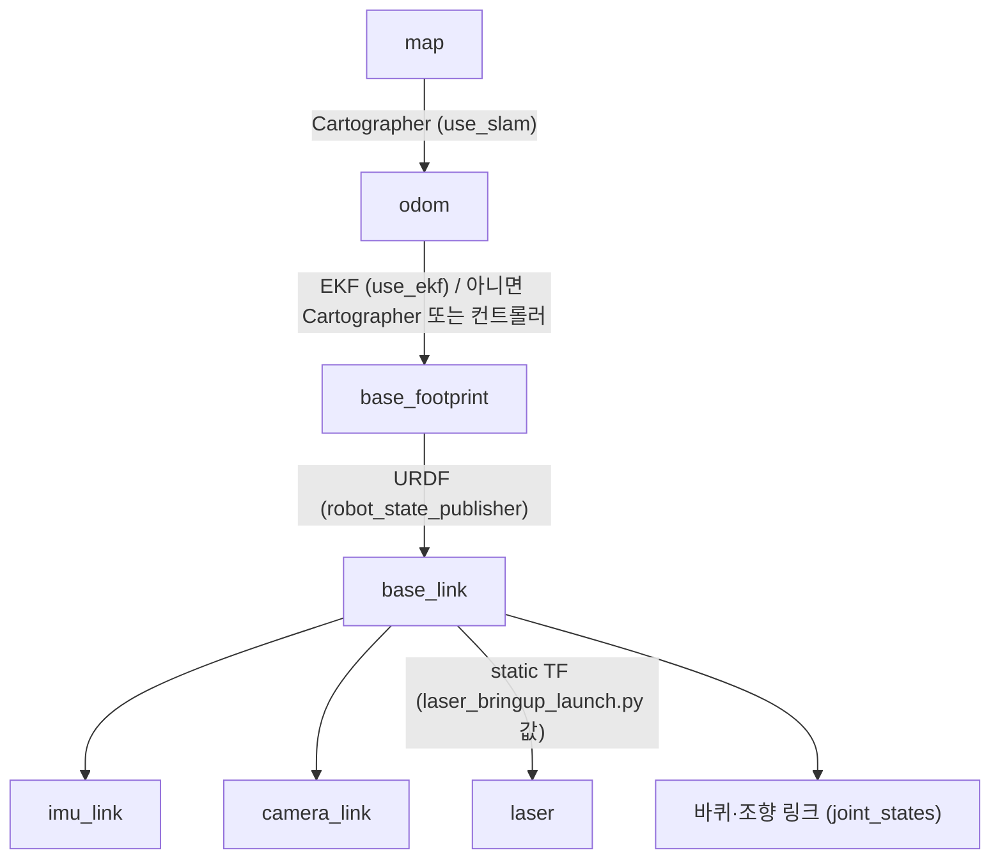
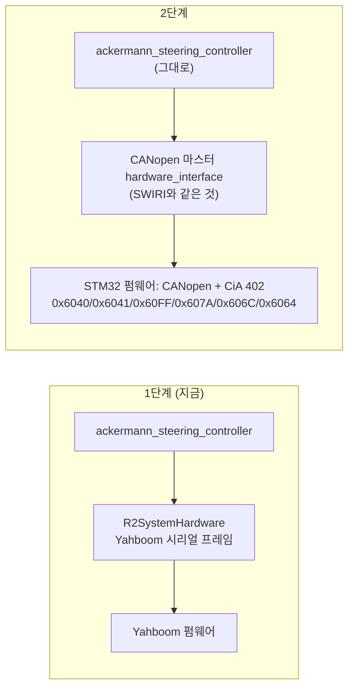

# yahboom_r2_bringup: ROSMASTER R2를 공통 플랫폼 구조로 구동

R2를 SWIRI·6족과 같은 구조(ros2_control + 표준 컨트롤러 + 센서 퓨전)로 돌리는 1단계 패키지입니다. STM32 펌웨어는 그대로 두고, Jetson 쪽 소프트웨어만 바꿉니다.

## 1. 구조



- **공통 계층(바꾸지 않음):** controller_manager, ackermann_steering_controller, joint_state_broadcaster, imu_sensor_broadcaster, robot_localization, Cartographer
- **R2 전용 3가지:** URDF(`yahboomcar_R2.ros2_control.xacro`), yaml(`config/`), 하드웨어 플러그인(`yahboom_r2_hardware`)

## 2. 센서 퓨전과 TF





`odom → base_footprint` 발행자는 항상 하나입니다.

| 조건 | odom→base_footprint | map→odom | /odom 토픽 |
|---|---|---|---|
| `use_ekf:=true` (기본) | EKF | Cartographer (`use_slam:=true`일 때) | EKF 출력 |
| `use_ekf:=false`, `use_slam:=true` | Cartographer (lidar-only lua) | Cartographer | 컨트롤러 odometry |
| `use_ekf:=false`, `use_slam:=false` | 컨트롤러 (`enable_odom_tf`) | 없음 | 컨트롤러 odometry |

- 컨트롤러 TF는 launch가 `enable_odom_tf`를 위 표대로 켜고 끕니다.
- rgbd_odometry는 `publish_tf: false`로 TF를 내지 않고, `/vo` 토픽만 EKF에 넣습니다.
- 기존 `base_node_R2`와 `Ackman_driver_R2`는 이 launch에서 띄우지 않습니다(같은 시리얼 포트와 TF를 쓰기 때문입니다).

## 3. 파일

| 위치 | 내용 |
|---|---|
| `yahboomcar_description/urdf/yahboomcar_R2.ros2_control.xacro` | `<ros2_control>` 블록 (조인트 6개 + IMU 센서) |
| `yahboomcar_description/urdf/yahboomcar_R2.urdf.xacro` | 끝에 include 추가. 인자 `use_ros2_control`(기본 false), `use_mock_hardware`, `serial_device` |
| `yahboom_r2_hardware/` | C++ SystemInterface 플러그인, 프로토콜, gtest |
| `config/controllers_jazzy.yaml`, `controllers_humble.yaml` | 컨트롤러 설정. 배포판마다 파라미터 이름이 달라 두 개로 나눴습니다 |
| `config/ekf.yaml` | EKF 설정 (컨트롤러 odom + IMU) |
| `config/r2_cartographer_fused.lua` | EKF와 함께 쓰는 Cartographer 설정 (map→odom만 발행) |
| `config/r2_cartographer_fused_depthscan.lua` | 위 설정 + 깊이 스캔을 2번째 레이저로 사용 |
| `config/r2_cartographer_lidar_only.lua` | `scripts/params/r2_cartographer.lua` 사본 (EKF 없이 사용) |
| `launch/r2_control.launch.py` | 1단계: robot_state_publisher + ros2_control_node + spawner |
| `launch/r2_bringup.launch.py` | 전체: 1단계 + EKF + LiDAR + 카메라 + Cartographer, 센서별 on/off |
| `scripts/cmd_vel_stamper.py` | Twist → TwistStamped (Jazzy 컨트롤러 입력용) |

## 4. 조인트와 기하 값

| 역할 | URDF 조인트 | 인터페이스 |
|---|---|---|
| 후륜 구동 (우, 좌) | `back_right_joint`, `back_left_joint` | command velocity / state position, velocity |
| 전륜 조향 (우, 좌) | `front_right_steer_joint`, `front_left_steer_joint` | command position (±0.6 rad, URDF limit) / state position, velocity |
| 전륜 바퀴 (표시용) | `front_right_wheel_joint`, `front_left_wheel_joint`(축 0 -1 0, 부호 -1) | state only |
| IMU | 센서 `imu_sensor`, 프레임 `imu_link` | orientation, angular_velocity, linear_acceleration |

| 값 | 크기 | 근거 |
|---|---|---|
| wheelbase | 0.23529 m | 조향 조인트 x 0.11922 − 후륜 조인트 x (−0.11607) |
| 후륜 트랙 | 0.1685 m | 후륜 조인트 y ±0.08425 |
| 조향 트랙 | 0.13 m | 조향 조인트 y ±0.065 |
| 바퀴 반지름 | 0.0345 m | `back_right_link.STL` 경계 상자 ±0.0345 |

- 기존 `base_node_R2`는 wheelbase 기본값 0.25를 씁니다. URDF 값과 다르니, 실차 직진·선회 시험으로 하나로 맞춰야 합니다.

## 5. 하드웨어 플러그인 동작

- **프로토콜:** `Rosmaster_Lib.py`(py_install V3.3.9, 미러 github.com/Roblibs/Rosmaster_Lib)를 그대로 옮겼습니다.
  - 송신: `set_car_motion` (FUNC_MOTION 0x12, car_type 5), `set_auto_report_state` (0x01), `reset_car_state` (0x0F), `set_car_type` (0x15, 기본 꺼짐)
  - 수신: `__receive_data` 상태기계와 `__parse_data`의 0x0A 속도, 0x0B MPU9250, 0x0E ICM20948, 0x0C 자세, 0x0D 엔코더
  - 체크섬: 송신 `(합 + 5) & 0xFF`, 수신 `(len + type + data) & 0xFF`
- **명령 변환:** 컨트롤러의 좌우 후륜 속도와 좌우 조향각을 차체 속도 vx와 등가 조향각 δ로 합친 뒤, `wz = vx·tanδ / L`로 바꿔 `set_car_motion(vx, 0, wz)`로 보냅니다. `Ackman_driver_R2.cmd_vel_callback`과 같은 명령입니다.
- **상태 변환:** 0x0A 보고의 vx와 조향각(`vy×1000` = deg, `base_node_R2`의 보정 0.90 적용)으로 좌우 바퀴 속도와 좌우 조향각을 계산합니다.
- **IMU:** `Ackman_driver_R2.pub_data`처럼 gz 부호를 뒤집고, 정지 중(|vx| < 0.03)에는 yaw rate를 0으로 둡니다. 둘 다 xacro 파라미터로 바꿀 수 있습니다.
- **안전:**
  - 0.5 s 동안 MCU 보고가 없으면 read()가 ERROR를 반환하고, controller_manager가 하드웨어를 비활성화합니다.
  - 비활성화할 때 정지 명령과 `reset_car_state`를 보냅니다.
  - 컨트롤러 `reference_timeout` 0.5 s가 지나면 /cmd_vel이 끊긴 것으로 보고 정지합니다.

### 한계

- MCU 자동 보고는 종류별로 40 ms마다 갱신됩니다(`set_auto_report_state` 주석). 그래서 상태는 실제로 25 Hz이고, 100 Hz 루프는 같은 값을 반복해서 읽습니다.
- 명령은 변할 때 최대 200 Hz, 변하지 않으면 20 ms마다 보냅니다. 115200 bps에서 13바이트 프레임이라 대역은 충분하지만, 펌웨어 내부 제어 주기는 확인하지 못했습니다.
- vx = 0이면 wz = 0이 되어 제자리에서 조향만 하는 명령은 보낼 수 없습니다. `set_car_motion` 구조의 한계입니다.
- 펌웨어가 wz를 서보 각도로 바꿀 때 쓰는 wheelbase는 확인하지 못했습니다. `mcu_wheelbase` 파라미터로 보정합니다.
- 좌우 바퀴 속도는 기본적으로 vx와 조향각에서 계산한 값입니다. MCU 엔코더 원값(0x0D)은 `/dev/shm/r2_encoder`에만 기록하며, `encoder_ticks_per_rev`는 0으로 둡니다. 엔코더 직접 사용은 모터 번호(M1~M4)와 한 바퀴당 틱 수를 확인한 뒤에 켜야 합니다. 절차는 `yahboom_r2_hardware/README.md`에 있습니다.
- IMU 축 부호(특히 yaw)는 실차에서 확인해야 합니다. 왼쪽으로 돌 때 `/imu/data_raw`의 `angular_velocity.z`가 양수여야 합니다.

## 6. Jetson에서 빌드·실행 (Humble 네이티브 기준)

```bash
# 1) 의존 패키지
sudo apt install ros-humble-ros2-control ros-humble-ros2-controllers \
  ros-humble-robot-localization ros-humble-xacro ros-humble-cartographer-ros \
  ros-humble-depthimage-to-laserscan ros-humble-rtabmap-odom
ros2 pkg list | grep -E "ackermann_steering_controller|imu_sensor_broadcaster"   # 둘 다 보여야 합니다

# 2) 빌드
cd ~/yahboomcar_ros2_ws/yahboomcar_ws      # NATIVE_WS_HOST
colcon build --symlink-install --packages-select yahboomcar_description yahboom_r2_hardware yahboom_r2_bringup
source install/setup.bash

# 3) 기존 스택 정지 (/dev/myserial을 잡고 있으면 열리지 않습니다)
bash ~/ROSMASTER-R2-fork/scripts/stop_robot_stack.sh
bash ~/ROSMASTER-R2-fork/scripts/disable_yahboom_autostart.sh
```

### 6.1 mock 시험 (모터 없이)

```bash
ros2 launch yahboom_r2_bringup r2_control.launch.py use_mock_hardware:=true
ros2 topic pub -r 10 /cmd_vel geometry_msgs/msg/Twist "{linear: {x: 0.3}, angular: {z: 0.5}}"
ros2 topic echo /odom            # vx 0.3, wz 0.5 확인
ros2 control list_hardware_interfaces
```

### 6.2 실차 시험 (바퀴를 띄운 상태로 먼저)

```bash
ros2 launch yahboom_r2_bringup r2_control.launch.py            # 하드웨어만
ros2 topic pub -r 10 /cmd_vel geometry_msgs/msg/Twist "{linear: {x: 0.1}}"
ros2 topic echo /joint_states
ros2 topic echo /imu/data_raw
```

- 확인 순서: 직진 방향 → 좌회전 시 조향 부호(+가 좌) → IMU yaw 부호 → 1 m 직진 오차 → 360° 선회 오차

### 6.3 센서 퓨전·SLAM

```bash
# EKF + LiDAR + Cartographer (기본 센서 구성)
ros2 launch yahboom_r2_bringup r2_bringup.launch.py use_slam:=true use_joy:=true
# 카메라 VO와 깊이 스캔까지
ros2 launch yahboom_r2_bringup r2_bringup.launch.py use_slam:=true use_camera:=true use_visual_odom:=true use_depth_scan:=true
# EKF 없이 기존 방식 (Cartographer lidar-only)
ros2 launch yahboom_r2_bringup r2_bringup.launch.py use_ekf:=false use_slam:=true
```

| 인자 | 기본값 | 내용 |
|---|---|---|
| `use_mock_hardware` | false | GenericSystem 사용 |
| `serial_device` | /dev/myserial | 확장보드 포트 |
| `use_imu` | true | imu_sensor_broadcaster |
| `use_ekf` | true | EKF가 odom→base_footprint 발행 |
| `use_lidar` / `lidar_type` | true / `$RPLIDAR_TYPE` 또는 4ROS | ydlidar(4ROS) 또는 sllidar(a1, s2) |
| `use_camera` | false | astra_camera `astro_pro_plus.launch.xml` |
| `use_visual_odom` | false | rtabmap `rgbd_odometry` → `/vo` → EKF |
| `use_depth_scan` | false | `/depth_scan` → Cartographer 2번째 scan |
| `use_slam` | false | Cartographer 2D |
| `use_joy` | false | joy_node + yahboom_joy_R2 |

- LiDAR TF는 `laser_bringup_launch.py`의 static TF(`base_link → laser`, x 0.0435, z 0.11)를 그대로 씁니다. URDF의 `laser_link`(x 0.0125, z 0.131, yaw π)와 값이 다르므로, 실측 후 하나로 맞춰야 합니다.

## 7. 2단계(CiA 402 펌웨어)에서 바뀌는 것



- **바뀌는 것:**
  - STM32 펌웨어: `protocol.c`의 Yahboom 프레임 대신 CANopen 객체 사전과 CiA 402 상태기계를 넣습니다. 후륜은 CSV(속도 모드), 조향은 CSP(위치 모드)로 바뀝니다.
  - 하드웨어 플러그인: `yahboom_r2_hardware` 대신 SWIRI용 CANopen hardware_interface를 씁니다. xacro의 `<plugin>`과 파라미터만 바꿉니다.
  - 연결: USB 시리얼 대신 보드의 CAN 포트(SN65HVD230)를 씁니다. 일반 CAN 1 Mbps입니다.
- **그대로인 것:** URDF 조인트 이름, controllers yaml, EKF, Cartographer, launch 구조
- 1단계에는 CiA 402가 없습니다. 지금은 Yahboom 고유 프레임(차체 속도 명령)을 ros2_control 인터페이스로 감싼 단계입니다.
